# Antares

*Retail sales analytics and a small data platform. (Formerly "Retail Sales Dashboard"; the repo and live URL keep the old name for now.)*

[](https://github.com/balamurugangethub/retail-sales-dashboard/actions/workflows/tests.yml)
[](https://github.com/balamurugangethub/retail-sales-dashboard/actions/workflows/pylint.yml)
[](https://github.com/balamurugangethub/retail-sales-dashboard/actions/workflows/warehouse.yml)
[](https://github.com/balamurugangethub/retail-sales-dashboard/actions/workflows/cloud-pipeline.yml)

**Live demo: https://retail-sales-dashboard-sigma.vercel.app** (click *Try with sample data* on the sign-in page)

A small data platform that started as a sales dashboard for a 5-store retail chain. It replaces the weekly
"merge Excel files from every store" routine with one live source of truth, and it works with any CSV or Excel
file: read it, clean it, check its quality, store it, query it with SQL, chart it and forecast it.
Behind it sits a **scheduled batch pipeline** with two feeds, about a million synthetic till lines and the real
**UCI Online Retail II** dataset (about a million invoice lines). Every morning **GitHub Actions** lands the files in a
**Supabase Storage** bucket, loads them into **MotherDuck** (cloud DuckDB), models them with **dbt** into two star
schemas, checks source freshness, records the run, and publishes a **data catalog** (dbt docs with lineage) to
GitHub Pages. The same steps run on a laptop with **Airflow** in Docker
(see [Data warehouse pipeline](#data-warehouse-pipeline) and the [data catalog](https://balamurugangethub.github.io/retail-sales-dashboard/)).

Built as the working prototype for the problem statement:
*"A retail chain with 5 stores cannot see its sales clearly or quickly."*

| Overview | Explore any data, with quality checks |
|---|---|
| 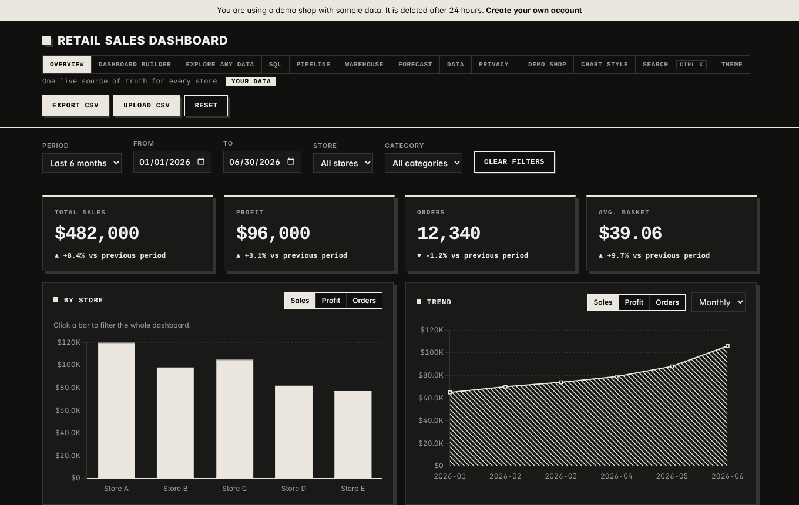 | 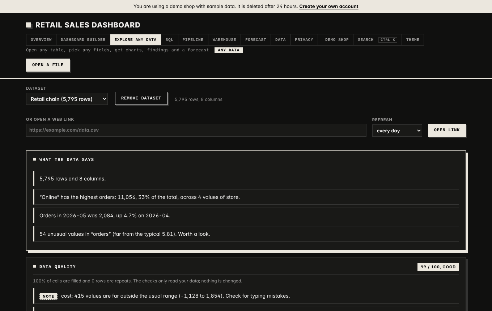 |
| **SQL workbench (read-only)** | **Pipeline view** |
| 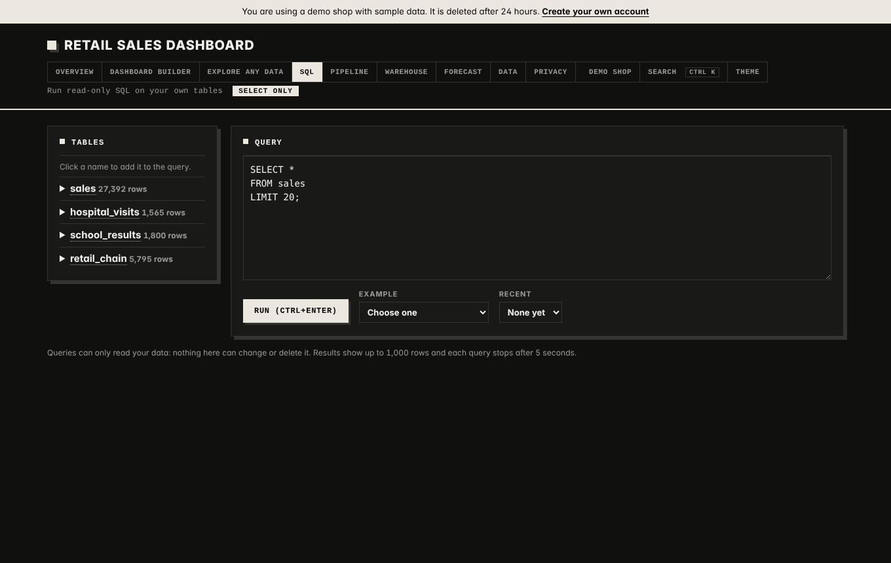 | 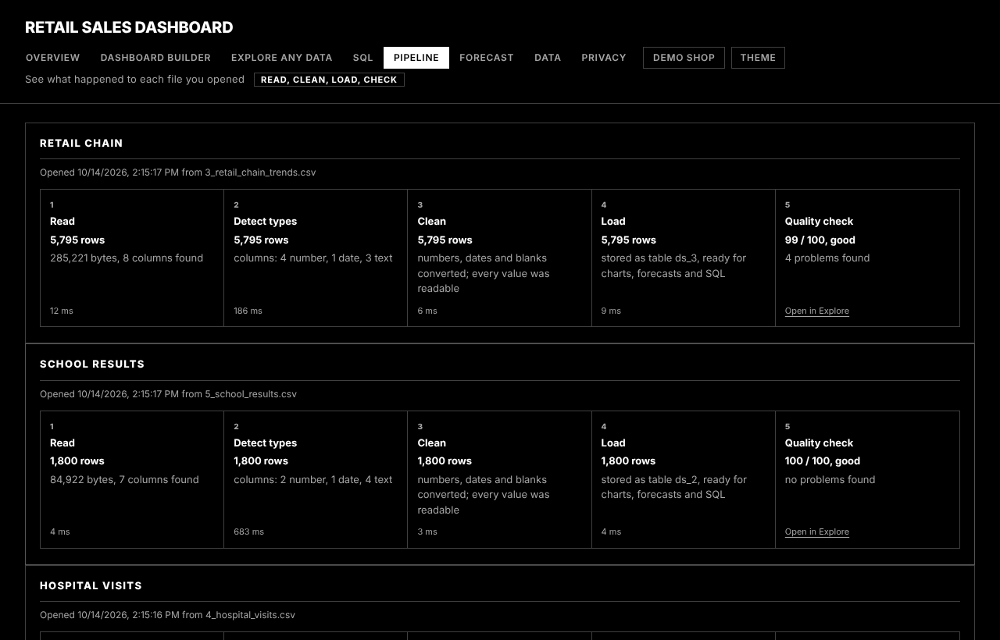 |
| **Warehouse page, reading the dbt marts** | **The Airflow DAG** |
| 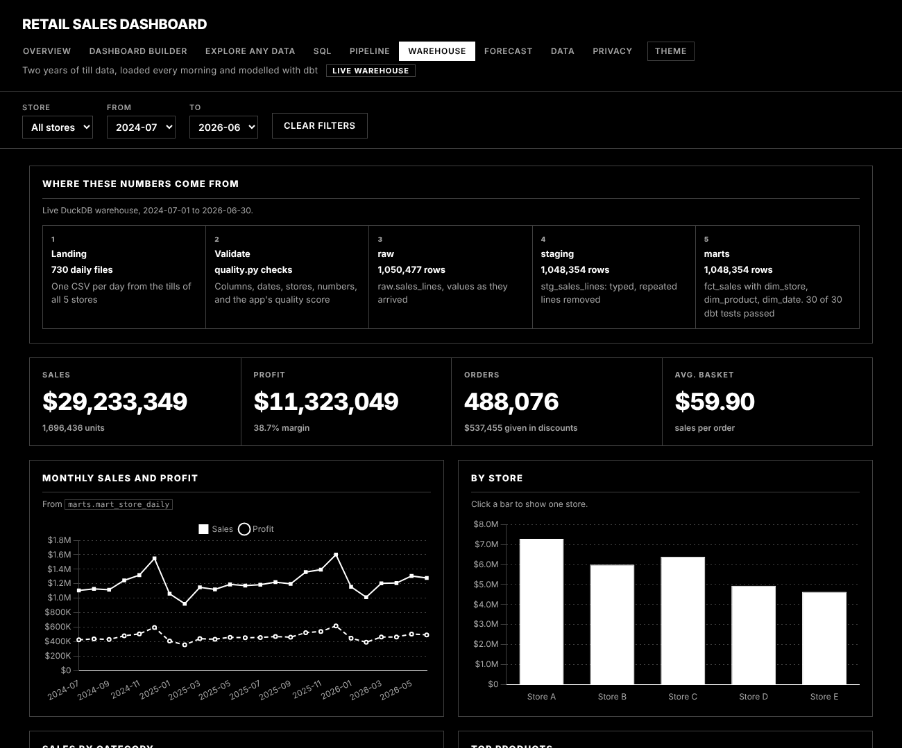 | 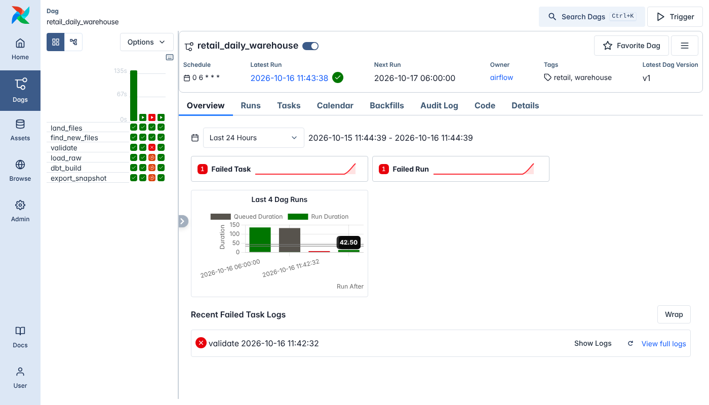 |

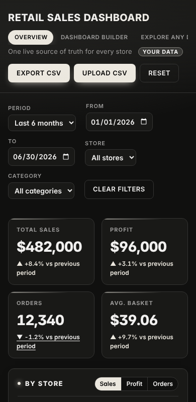

## What this project shows

| Skill | Where to look |
|---|---|
| Batch pipeline and orchestration | `warehouse/`: a daily GitHub Actions run in the cloud and an Airflow DAG in Docker Compose, idempotent loads, quarantine and alerts |
| Cloud data platform | object-storage landing zone (Supabase Storage, S3-style), cloud warehouse (MotherDuck), secrets in GitHub, all on free plans (`warehouse/cloud_run.py`, `object_store.py`) |
| Real data | UCI Online Retail II (1.07M real invoice lines) as a second feed with its own validation rules (`warehouse/online_retail.py`, `feeds.py`) |
| Data warehouse and modelling | raw, staging and mart layers; dbt star schemas (`fct_sales`, `fct_online_sales` and their dimensions), incremental fact, 51 dbt tests |
| Data catalog and observability | dbt docs with lineage on GitHub Pages; run history, step timings, dbt results and source freshness in the warehouse (`warehouse/observe.py`), shown on the Warehouse page |
| Ingestion from files and web links | `cleaning.py`, `datasets.py`, `sources.py` (links are checked so the server cannot be pointed at private addresses) |
| Data cleaning and type detection | `cleaning.py`, `typed_rows` in `datasets.py` |
| Data quality checks and scoring | `quality.py` |
| Pipeline history and lineage | `pipeline_runs` and `dataset_sources` tables, the Pipeline page |
| SQL | `sqlbench.py`: a read-only workbench using a SQLite authorizer, time and row limits, and readable views over generated tables |
| Storage design | one SQLite database per account, synced to Supabase on a host with no permanent disk (`cloud.py`) |
| Analytics and forecasting | `queries.py`, `forecast.py` |
| Security and privacy | consent gate, scrypt password hashes, login lockout, no write access from SQL |
| Testing and CI | 175+ pytest tests, GitHub Actions for tests, pylint, and a pipeline job that runs dbt and builds the Airflow image |

## Run it

```bash
pip install -r requirements.txt
python app.py
```

Open http://127.0.0.1:5000 (Windows: double-click `run.bat`).
The database (`retail.db`) is created and filled with sample data on first start.
Charts are bundled in `static/vendor`, so it works offline.

## Accounts, privacy and cookies

1. **Welcome screen.** On the first visit, people see a short privacy summary with **Accept** and **Decline**.
   Declining stores nothing and keeps the app closed. The full policy is at `/privacy`.
2. **Sign in or create an account** (`/login`, `/register`). Creating an account requires ticking the privacy policy box.
   Passwords are stored as salted scrypt hashes. After 5 wrong passwords the email is locked for 5 minutes.
3. **Separate data per account.** Each account gets its own database (`userdata/shop_<id>.db`), which starts with the
   sample data. Uploads, edits and saved dashboards never mix between shops.
4. **Your account** (`/account`). Shows when the policy was accepted, and has buttons to download your data,
   sign out, or delete the account together with all of its data.

Only two cookies are used, and both are essential: `rsd_session` keeps you signed in for 14 days, and `rsd_consent`
remembers your choice for a year. There are no analytics or advertising cookies.

| Setting | What it does |
|---|---|
| `SECRET_KEY` | Signs the login cookie. If it is not set, a random key is created in `userdata/secret_key` |
| `PRIVACY_CONTACT` | Email address shown on the privacy page for questions |
| `AUTH=0` | Switches sign-in off for a single-user computer. The welcome screen still shows |

The public Vercel demo is read-only and resets on every cold start, so it shows the welcome screen but no sign-in.
Real accounts on a hosted site need a hosted database such as Supabase or Postgres.

## Architecture

GitHub draws this diagram itself from the text below, so it stays editable in this file.

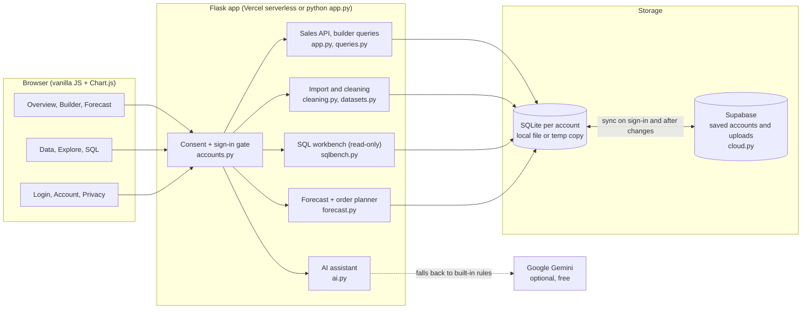

Every request goes through the consent and sign-in gate first. Each account has its own SQLite database. On the
hosted site that database is loaded from Supabase when you sign in and saved back after each change, so uploads
survive restarts. `/api/status` shows whether online storage and sign-in are switched on.

### How your data flows

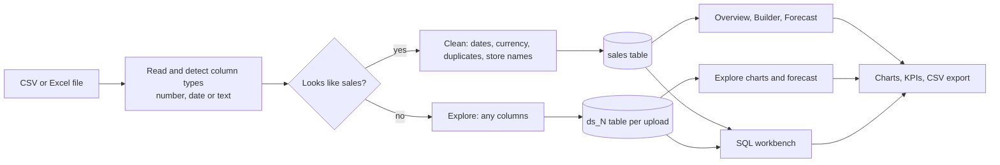

Sales-shaped files are cleaned and loaded into the `sales` table. Any other file becomes its own table, so the app
works with data of any shape. The SQL workbench can read both, but only with SELECT.

### Sign-in and storage sync

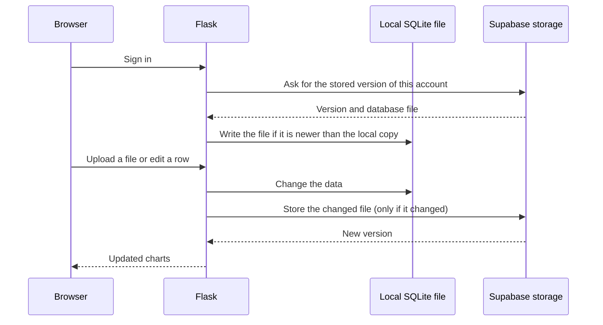

The hosted site runs on a temporary disk, so the database file is the source of truth only while the server is
awake. Supabase keeps the saved copy, and a server never overwrites a stored copy it has not fetched first.

## What it does

The app's pages are linked from the header. The first three are the original sales dashboard; the rest work with any data.

### Overview (`/`)
- **KPI tiles:** sales, profit, orders, average basket, each with % change vs the previous period.
- **Click to filter**, period/store/category filters, metric switch, store x month heatmap, top products.
- **Insights:** best and weakest store, stores more than 15% below average, growth, top category, peak month.

### Dashboard builder (`/builder`), Cognos-style
- **Field list:** measures (sales, profit, cost, orders, units, margin %, avg. basket, avg. unit price) and
  dimensions (store, category, product, year, quarter, month, week, day, day of week).
- **Drag a field onto the canvas** to create a chart, or **drag it onto a chart** to add it there.
- **Double-click a field** to add it to the selected chart (or to a new chart if none is selected).
  On a phone or tablet, a single tap does the same.
- The chart type is picked automatically (trend for time, pie for category mix, KPI for a single number)
  and can be switched: bar, horizontal bar, stacked bar, line, area, pie, KPI, table.
- Top 5 / 10 / 20 or bottom 5, four sizes, drag charts by their header to reorder, double-click a title to rename.
- Global filters (period, store, category) and **saved, named dashboards**.

### Data (`/data`)
- **Import with cleaning:** CSV, TSV or Excel (.xlsx). Column names don't have to match: "Branch",
  "Outlet", "Amount", "Qty", "Bill Date" and many more are recognised, and you can correct the mapping.
  The cleaner converts any common date format (it works out day/month order from the whole column),
  strips currency symbols and thousands separators, merges spelling variants ("store a", "STORE A"),
  removes exact duplicate rows (optional), calculates sales from price x units when needed, and fills
  sensible defaults for a single shop (no store column = "Main store").
  You see a report of every fix and every skipped row **before** anything is saved.
- **Edit in place:** search, filter, sort, double-click a cell to edit it, delete rows.
- **Bulk fixes:** tidy everything, rename or merge a store/category/product, delete all rows for one.
- **Export** to CSV and **restore** the sample data.

### Explore any data (`/explore`)
- **Open any file** (CSV, TSV, Excel) or a **web link**. Linked files show when they were last refreshed and refresh
  themselves when you open them after the time you chose (every day, 6 hours, hour or only when asked).
- **What the data says** (plain-English findings), **Data quality** (score out of 100: empty values, repeated rows,
  odd spellings, numbers far outside the usual range, future dates), a chart builder and a forecast.

### SQL (`/sql`)
Write `SELECT` queries on your own tables. Each file shows up as a table with readable names. Queries can only read:
they stop after 5 seconds or 1000 rows and cannot reach anything but your tables.

### Pipeline (`/pipeline`)
Every file with the steps it went through (read, detect types, clean, load, quality check), row counts and timings.

### Warehouse (`/warehouse`)
Two years of sales for the 5 stores, read from the dbt marts rather than the app's own table: KPIs, monthly trend,
stores, categories, top products, row counts at each layer, dbt test results and the latest pipeline loads.
Filter by store and month. Below that: **Pipeline health** (the last runs with their duration, rows, rejected files,
dbt tests, success rate, the steps of the last run and dbt source freshness), the **real data** section for the online
shop (net sales, returns, countries, best sellers), and a link to the data catalog. See [Data warehouse pipeline](#data-warehouse-pipeline).

### Demo accounts
The sign-in page has **Try with sample data**: a private demo shop with sample sales and three sample files,
deleted after 24 hours.

### AI assistant
A chat panel in the builder. Examples:
"build a dashboard for Store B", "top 5 products by profit", "profit by month as a line",
"which store is falling behind?", "what were total sales in Grocery?", "rename Store A to Downtown",
"merge Store E into Store D", "clean my data".

It adds charts directly. Anything that changes data (rename, delete, tidy) is shown as a card you must confirm.

Out of the box a built-in rule engine answers, so the app works offline with no account. For smarter,
free-form answers, connect a **free AI model** (no credit card needed). The model gets the field list,
your store/category names and a summary of the numbers for the current filters, and must answer in a
fixed JSON format; the app checks every action against the real fields and values before using it.
If the AI service fails, the rule engine answers instead. The badge in the panel shows which one is active.

#### Connect a free AI model (Google Gemini, recommended)
1. Sign in at https://aistudio.google.com/apikey with a Google account and click **Create API key**.
   It's free and doesn't ask for a card.
2. In Windows PowerShell, in the app folder, run one at a time:

```powershell
$env:AI_API_KEY = "your-gemini-key"
```

```powershell
python app.py
```

The assistant badge now shows **Google Gemini**. Never commit the key; on Vercel add `AI_API_KEY` under
Project Settings > Environment Variables (note that public visitors would then use your free quota).

Other free options, set with `AI_PROVIDER`:

| `AI_PROVIDER` | Key | Notes |
|---|---|---|
| `gemini` (default when only `AI_API_KEY` is set) | https://aistudio.google.com/apikey | model `gemini-2.5-flash` |
| `groq` | https://console.groq.com/keys | model `llama-3.3-70b-versatile`, very fast |
| `ollama` | none | runs on your own computer after installing https://ollama.com and `ollama pull llama3.2` |

`AI_MODEL` picks a different model (for example if the default is retired), and `AI_BASE_URL` points to any
other OpenAI-compatible service.

## Sample data matches the presentation

Jan-Jun 2026: sales **$482K**, profit **$96K**, **12,340** orders, avg basket **$39.06**;
stores A-E = 120 / 98 / 105 / 82 / 77 ($K); monthly 65 / 70 / 74 / 79 / 88 / 106 ($K).
Versus the previous 6 months: sales +8.4%, profit +3.1%, orders -1.2%, avg basket +9.7%.
The data is generated (`seed.py`, calibrated from `data/targets.csv`); it is not real company data.

## API

All GET endpoints accept `start`, `end` (YYYY-MM-DD), `store`, `category`.

| Endpoint | Returns |
|---|---|
| `GET /api/meta` | stores, categories, date range, row count |
| `GET /api/kpis` | current vs previous period totals and % change |
| `GET /api/by-store`, `/api/categories`, `/api/heatmap` | grouped sales |
| `GET /api/trend?grain=month\|week\|day` | time series |
| `GET /api/top-products?limit=8` | best sellers |
| `GET /api/insights` | generated findings |
| `GET /api/export.csv` | filtered rows as CSV |
| `POST /api/upload` (form: `file`, `mode`) | strict import (exact column names) |
| `POST /api/reset` | restore sample data |
| `GET /api/fields` | measures, dimensions, chart types, store/category/product names, assistant provider |
| `GET /api/query?dims=store,month&measures=sales,profit&sort=-sales&limit=10` | data for one builder chart |
| `GET/POST /api/dashboards`, `GET/PUT/DELETE /api/dashboards/<id>` | saved dashboards |
| `POST /api/import/preview` (form: `file`, optional `mapping` JSON, `drop_duplicates`) | cleaning report, nothing saved |
| `POST /api/import/commit` (`{"import_id", "mode"}`) | save a previewed import |
| `GET /api/rows`, `PATCH/DELETE /api/rows/<id>` | browse and edit rows |
| `POST /api/data/rename`, `/api/data/delete`, `/api/data/tidy` | bulk fixes |
| `POST /api/assistant` (`{"message", "filters"}`) | assistant reply + proposed actions |

| `GET /api/datasets`, `POST /api/datasets`, `GET/DELETE /api/datasets/<id>` | uploaded files of any shape |
| `POST /api/datasets/from-url` (`{"url", "hours"}`), `POST /api/datasets/<id>/refresh` | open a web link, refresh it |
| `GET /api/datasets/<id>/quality` | data quality score and problems |
| `POST /api/datasets/<id>/query`, `/forecast` | chart data and forecast for any file |
| `GET /api/pipeline` | steps each file went through |
| `GET /api/warehouse?store=&start=YYYY-MM&end=YYYY-MM` | Warehouse page: KPIs, trend, stores, categories, top products, the online shop's real data, pipeline health (runs, steps, freshness) and load history from the dbt marts |
| `GET /api/sql/schema`, `POST /api/sql/run` | tables you can query, run a read-only query |
| `POST /api/auth/demo` | open a demo account |
| `POST /api/consent` (`{"accept": true/false}`) | accept or decline the privacy policy and cookies |
| `GET /api/auth/me` | consent state and the signed-in user |
| `POST /api/auth/register`, `/api/auth/login`, `/api/auth/logout` | accounts |
| `POST /api/account/delete` (`{"password"}`) | delete the account and all of its data |

Without consent, every other endpoint returns 401. Without sign-in, they also return 401.
Serve the app over HTTPS when it is reachable from other computers.

## Tests

```bash
python -m pytest -q
```

Tests check that totals match the presentation, filters apply everywhere, bad input is rejected,
SQL injection is harmless, upload/reset behave correctly, messy files are cleaned as expected, the
builder query and saved dashboards work, the consent gate and sign-in work, accounts never see each
other's data, and the assistant behaves with and without an AI model
(a fake AI client is used, so no key is needed).

## Files

```
app.py            Flask app, overview API + SQLite
accounts.py       privacy/cookie consent gate, sign-in, one database per account
workspace.py      builder, import/cleaning, editing and assistant routes
datasets.py       uploads of any CSV/Excel file (Explore page), one table per upload, pipeline history
quality.py        data quality checks and score
sources.py        safe download of web links
sqlbench.py       read-only SQL workbench over your tables
forecast.py       forecast and order planner
cloud.py          Supabase storage so accounts and uploads persist on the hosted site
cleaning.py       reads CSV/Excel, guesses columns, cleans rows
queries.py        field catalog and the generic chart query
ai.py             AI chat client (Gemini/Groq/Ollama), rule-based assistant, action validation
seed.py           sample-data generator (calibrated to the deck)
marts.py          Warehouse page: reads the dbt marts (live DuckDB, the snapshot published to GitHub Pages, or the committed one)
warehouse/        batch pipeline: generator, validation, loading, alerts, dbt project, Airflow DAG (see warehouse/README.md)
data/targets.csv  store x month targets used by the generator
static/           index/builder/data, welcome/privacy/sign-in/account pages, JS, style.css, vendor/chart.umd.min.js
tests/            pytest suite (run on every push by GitHub Actions)
docs/             screenshots, hosting notes
```

## Data warehouse pipeline

The app above stores what people upload. The warehouse answers the original problem at a realistic size: each store's
till sends one file a day, and the chain needs one trusted set of numbers every morning. It runs in the cloud every
day, and the same code runs on a laptop. Everything is on free plans with no credit card.

| | |
|---|---|
| Data | Two feeds, one CSV per day each. **Tills** (`warehouse/generate.py`): seeded synthetic data, 5 stores x 60 products, 730 daily files, **1,050,477 order lines** with seasonality, weekends, growth and a little dirt. **Online shop** (`warehouse/online_retail.py`): the real [UCI Online Retail II](https://archive.ics.uci.edu/dataset/502/online+retail+ii) dataset (CC BY 4.0), a UK gift shop's **1,067,371 invoice lines** from Dec 2009 to Dec 2011, downloaded by a script and split by day |
| Orchestration | Cloud: a GitHub Actions workflow (`cloud-pipeline.yml`) at 06:15 UTC daily. Laptop: Airflow 3 in Docker Compose, DAG `retail_daily_warehouse` |
| Landing zone | Cloud: a private **Supabase Storage** bucket (`landing/`, `quarantine/`), used the way S3 or GCS would be. Laptop: a folder |
| Validation | `warehouse/validate.py` with per-feed rules (`feeds.py`) and the app's `quality.py` score. A failing file stops the run, moves to quarantine and sends an alert (Discord/Slack webhook, or a log) |
| Warehouse | Cloud: **MotherDuck** (DuckDB as a service). Laptop: a DuckDB file. Both have `raw`, `staging` and `marts` schemas |
| Transformations and tests | dbt: typed and de-duplicated staging, two star schemas (one with an incremental fact table), reporting marts, 51 tests |
| Data catalog | `dbt docs generate --static`, published to [GitHub Pages](https://balamurugangethub.github.io/retail-sales-dashboard/) after every run: every model and column described, the lineage graph, column types from the warehouse |
| Observability | Every run writes `raw.pipeline_runs`, `raw.pipeline_steps`, `raw.dbt_results` and `raw.source_freshness` (`warehouse/observe.py`): status, duration per step, files found, loaded and rejected, rows, dbt models and tests, and `dbt source freshness` (warn after 30 hours, error after 72). Stale data sends an alert. The Warehouse page shows it as Pipeline health |
| Serving | The Warehouse page reads the marts live when the DuckDB file is there. On Vercel it reads the snapshot each cloud run publishes to GitHub Pages, and falls back to the copy committed in `warehouse/snapshot/` |

How to run it, on Windows, with Docker, or in the cloud: [warehouse/README.md](warehouse/README.md).

### Cloud architecture

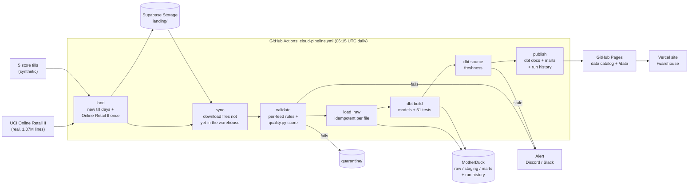

The same design on the big clouds:

| Here (free) | AWS | Google Cloud | Azure |
|---|---|---|---|
| Supabase Storage bucket | S3 | Cloud Storage (GCS) | Blob Storage / ADLS |
| MotherDuck | Redshift, or Snowflake / Athena on Iceberg | BigQuery | Synapse / Fabric |
| GitHub Actions schedule | MWAA (managed Airflow) or Step Functions | Cloud Composer or Workflows | Data Factory |
| GitHub secrets | Secrets Manager | Secret Manager | Key Vault |
| dbt docs on GitHub Pages | dbt docs on S3 + CloudFront, or DataHub | Dataplex catalog | Purview |
| `raw.pipeline_runs` + webhook alerts | CloudWatch metrics and alarms | Cloud Monitoring | Azure Monitor |

Moving to one of them means swapping `object_store.py` for the provider's SDK and the dbt profile for its adapter
(`dbt-bigquery`, `dbt-snowflake`, `dbt-redshift`); validation, the models, the tests and the run history stay the same.

### Laptop architecture (Airflow)

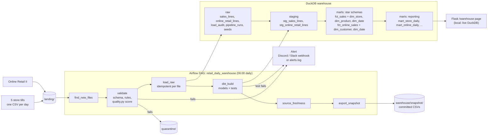

### Star schema

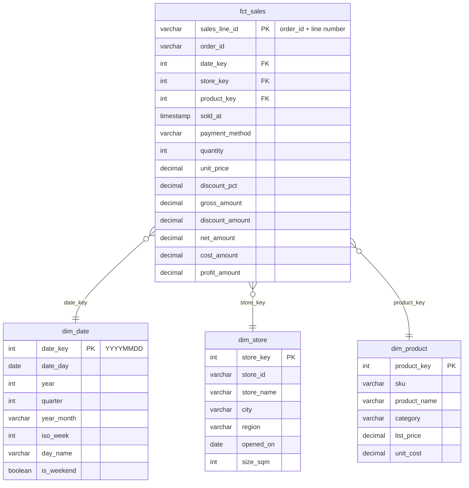

The fact table's grain is one order line. It is incremental: each run adds only lines loaded since the last run, and
a file that is loaded again replaces its earlier lines (`delete+insert` on `sales_line_id`).

The online shop has its own star: `fct_online_sales` (one row per invoice line, with `is_cancellation` and
`is_product` flags) joins to `dim_date` and `dim_customer`, and feeds `mart_online_daily`,
`mart_online_country_monthly` and `mart_online_top_products`. Its own tests check that cancellations never add
units and that the marts add up to the fact table.

### What I'd do at 100x scale

100x is 500 stores, or about 100 million order lines over two years (roughly 150,000 a day). DuckDB on one machine
can still query that, so the first things to break are not query speed but single-writer storage, Python-side
validation, and one big daily batch.

| Area | Today | At 100x |
|---|---|---|
| Landing | CSV files in a bucket (Supabase Storage) or a local folder | Files land in object storage (S3 or GCS) as Parquet, partitioned by `date/store`, written by the stores' POS export. CSV is converted once on arrival |
| Ingestion | One run picks up all new files | One task per store partition with Airflow dynamic task mapping, triggered by the file arriving (Airflow assets or an object-storage event) instead of a fixed 06:00 batch. Late files reprocess only their own partition |
| Validation | Python reads each file and runs `quality.py` in SQLite | The same rules as SQL in the warehouse (dbt tests or Soda/Great Expectations on the raw partition), plus a data contract on the file schema. Quarantine per partition, so one bad store doesn't hold back 499 good ones |
| Warehouse | MotherDuck or one DuckDB file, one writer at a time | A shared warehouse with concurrent readers and writers: BigQuery, Snowflake or Postgres with partitioning, or Iceberg tables on object storage queried by DuckDB/Trino. Raw tables partitioned by date and clustered by store |
| Transformations | Incremental fact on `_loaded_at` | Incremental `insert_overwrite` by date partition with a few days of lookback for late data; dbt snapshots (SCD type 2) for product prices and store attributes; slim CI that builds only changed models (`state:modified+`) |
| Orchestration | A GitHub Actions schedule, or Airflow standalone with a SQLite metadata DB | Managed Airflow (MWAA, Cloud Composer or Astronomer) or Celery/Kubernetes executors with a Postgres metadata DB, SLAs per task, retries with backoff |
| Serving | Flask reads small marts into memory | Dashboards hit pre-aggregated marts or a semantic layer with caching; the fact table is never scanned by a page view |
| Observability | Run history, step timings, dbt results and source freshness in the warehouse; alerts on failure and stale data; dbt docs as the catalog | Row-count and revenue anomaly detection per store, lineage with OpenLineage, alerts routed to an on-call channel with a runbook link |
| Cost and governance | Free tools | Partition pruning and clustering to keep scans small, separate dev and prod targets, role-based access to customer-level data |

## Ideas for next steps

Staff roles within a shop, password reset by email, sales targets and alerts, a timer-based refresh for linked files
(today they refresh when opened, because the hosted site has no always-on server), connecting to a real POS, and a
scheduled weekly summary email.
